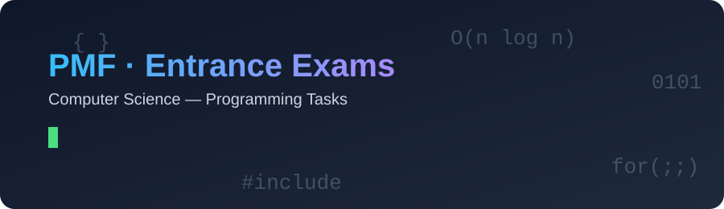
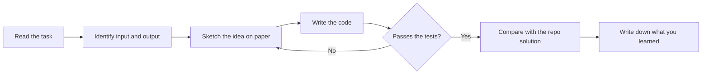

<div align="center">

[🇷🇸 Srpski](README.sr.md) · 🇬🇧 **English**



<a href="https://github.com/MIhajloS07/Faculty-of-Natural-Sciences-and-Mathematics-Computer-science-entrance-exams-programming">
  
</a>

<br/><br/>


[](../../commits)
[](../../stargazers)
[](../../network/members)

**[📚 About](#-about) · [🗂 Structure](#-repository-structure) · [🚀 Running](#-running-the-code) · [🧠 Topics](#-topics-covered) · [🤝 Contributing](#-contributing)**

</div>

---

## 📚 About

This repository contains **programming tasks from the Computer Science entrance exams at the Faculty of Natural Sciences and Mathematics**, together with solutions and explanations.

The goal is to help future students prepare: to see how tasks look year after year, to run the solutions, and to learn the patterns that keep coming back.

> 💡 **Tip:** Try to solve each task on your own first, then open the solution.

### ✨ What you'll find here

- 📝 Task statements organised by year and exam period
- 💻 Solutions in code, with comments
- 🧩 Explanation of the idea and complexity (time and space)
- ✅ Sample inputs and outputs for testing
- 🗺 An overview of topics so you know what to review

---

## 🗂 Repository structure

<!-- TODO: replace with the real structure (e.g. output of `tree -L 2`) -->

```text
.
├── assets/                # images and animations for the README
├── 2023/
│   ├── june/
│   │   ├── task1/
│   │   │   ├── task.md        # task statement
│   │   │   ├── solution.cpp   # C++ solution
│   │   │   └── test/          # input1.txt, output1.txt, ...
│   │   └── ...
│   └── september/
├── 2024/
├── Makefile               # build & test everything
├── run.sh                 # run a single task
├── .gitignore
├── README.md              # English
├── README.sr.md           # Serbian
├── CONTRIBUTING.md
└── LICENSE
```

---

## 🚀 Running the code

Everything in this repository is written in **C++17**. You only need a compiler (`g++` or `clang++`).

| OS | Install |
|----|---------|
| 🐧 Linux | `sudo apt install g++ make` |
| 🍎 macOS | `xcode-select --install` |
| 🪟 Windows | [MSYS2](https://www.msys2.org/) or WSL, then `pacman -S mingw-w64-ucrt-x86_64-gcc make` |

**Single task, manually:**

```bash
g++ -std=c++17 -O2 -Wall -Wextra -o solution solution.cpp
./solution < test/input1.txt
```

**Single task, with the helper script** (compiles, runs every test and compares the output):

```bash
bash run.sh 2023/june/task1
```

```text
▶ Compiling 2023/june/task1/solution.cpp ...
✅ test 1 passed
✅ test 2 passed
❌ test 3 failed
```

**The whole repository:**

```bash
make test     # compile and test every task
make clean    # remove compiled binaries
```
---

## 🧠 Topics covered

| Topic | Typical tasks | Difficulty |
|-------|---------------|:----------:|
| 🔢 Math and numbers | digits, GCD/LCM, primes, divisibility | ⭐ |
| 📦 Arrays and matrices | C arrays, `std::vector`, traversal, rotation, spiral output | ⭐⭐ |
| 🔤 Strings | `std::string`, palindromes, counting, transformations | ⭐⭐ |
| 🔁 Recursion | permutations, combinations, backtracking | ⭐⭐⭐ |
| 📊 Sorting and searching | `std::sort`, comparators, binary search | ⭐⭐ |
| 🧮 Dynamic programming | longest common subsequence, knapsack | ⭐⭐⭐ |

<!-- TODO: align this table with the topics that actually exist in the repo -->

---

## 🗺 How to prepare



---

## 📈 Statistics

<!-- TODO: fill in manually or via a GitHub Action -->

| | |
|---|---|
| Total tasks | TODO |
| Exam periods covered | TODO |
| Language | C++17 |

---

## 🤝 Contributing

Contributions are welcome: new tasks, better solutions, bug fixes and translations.

1. Fork the repository
2. Create a branch: `git checkout -b add-task-2024-june`
3. Add the task to the matching folder, following the existing structure (`task.md`, `solution.cpp`, `test/`)
4. Make sure it compiles without warnings and `make test` passes
5. `git commit -m "Add task 3 (June 2024)"`
6. Open a Pull Request

---

## 📜 License

The code is released under the **MIT** license. Task statements belong to the faculty and are included here for educational purposes only.

---

<div align="center">

**If this repository helped you, leave a ⭐**

Made by [MihajloS07](https://github.com/MIhajloS07)


</div>
