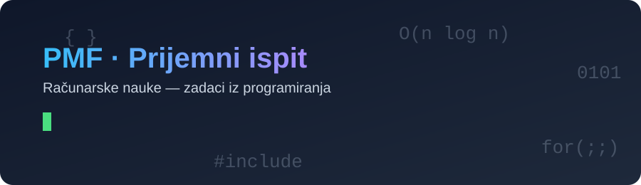
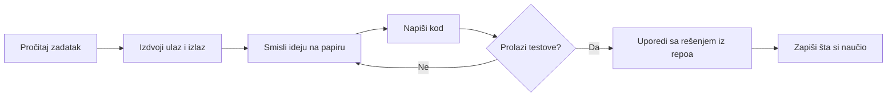

<div align="center">

🇷🇸 **Srpski** · [🇬🇧 English](README.md)




<a href="https://github.com/MIhajloS07/Faculty-of-Natural-Sciences-and-Mathematics-Computer-science-entrance-exams-programming">
  
</a>

<br/><br/>


[](../../commits)
[](../../stargazers)
[](../../network/members)

**[📚 O projektu](#-o-projektu) · [🗂 Struktura](#-struktura-repozitorijuma) · [🚀 Pokretanje](#-pokretanje) · [🧠 Teme](#-teme-koje-se-pojavljuju) · [🤝 Doprinos](#-doprinos)**

</div>

---

## 📚 O projektu

Ovaj repozitorijum sadrži **zadatke iz programiranja sa prijemnih ispita za studije računarskih nauka na Prirodno-matematičkom fakultetu (PMF)**, zajedno sa rešenjima i objašnjenjima.

Cilj je da budućim studentima olakša pripremu: da vide kako izgledaju zadaci iz godine u godinu, da isprobaju rešenja i da nauče obrasce koji se stalno ponavljaju.

> 💡 **Savet:** Prvo pokušaj da rešiš zadatak sam, pa tek onda otvori rešenje.

### ✨ Šta ćeš ovde naći

- 📝 Tekstove zadataka organizovane po godini i roku
- 💻 Rešenja u kodu, sa komentarima
- 🧩 Objašnjenje ideje i složenosti (vremenske i prostorne)
- ✅ Primere ulaza i izlaza za testiranje
- 🗺 Pregled tema da znaš šta da ponavljaš

---

## 🗂 Struktura repozitorijuma

<!-- TODO: zameni stvarnom strukturom (npr. izlaz komande `tree -L 2`) -->

```text
.
├── assets/                # slike i animacije za README
├── 2023/
│   ├── jun/
│   │   ├── zadatak1/
│   │   │   ├── zadatak.md     # tekst zadatka
│   │   │   ├── resenje.cpp    # C++ rešenje
│   │   │   └── test/          # ulaz1.txt, izlaz1.txt, ...
│   │   └── ...
│   └── septembar/
├── 2024/
├── Makefile               # kompajlira i testira sve
├── run.sh                 # pokreće jedan zadatak
├── .gitignore
├── README.md              # engleski
├── README.sr.md           # srpski
├── CONTRIBUTING.md
└── LICENSE
```

---

## 🚀 Pokretanje

Sve u ovom repozitorijumu je napisano u **C++17**. Potreban ti je samo kompajler (`g++` ili `clang++`).

| OS | Instalacija |
|----|-------------|
| 🐧 Linux | `sudo apt install g++ make` |
| 🍎 macOS | `xcode-select --install` |
| 🪟 Windows | [MSYS2](https://www.msys2.org/) ili WSL, pa `pacman -S mingw-w64-ucrt-x86_64-gcc make` |

**Jedan zadatak, ručno:**

```bash
g++ -std=c++17 -O2 -Wall -Wextra -o resenje resenje.cpp
./resenje < test/ulaz1.txt
```

**Jedan zadatak, preko pomoćne skripte** (kompajlira, pokreće sve testove i poredi izlaz):

```bash
bash run.sh 2023/jun/zadatak1
```

```text
▶ Kompajliram 2023/jun/zadatak1/resenje.cpp ...
✅ test 1 prošao
✅ test 2 prošao
❌ test 3 pao
```

**Ceo repozitorijum:**

```bash
make test     # kompajlira i testira svaki zadatak
make clean    # briše kompajlirane fajlove
```
---

## 🧠 Teme koje se pojavljuju

| Tema | Tipični zadaci | Težina |
|------|----------------|:------:|
| 🔢 Matematika i brojevi | cifre, NZD/NZS, prosti brojevi, deljivost | ⭐ |
| 📦 Nizovi i matrice | C nizovi, `std::vector`, obilazak, rotacija, spiralni ispis | ⭐⭐ |
| 🔤 Stringovi | `std::string`, palindromi, brojanje, transformacije | ⭐⭐ |
| 🔁 Rekurzija | permutacije, kombinacije, backtracking | ⭐⭐⭐ |
| 📊 Sortiranje i pretraga | `std::sort`, komparatori, binarna pretraga | ⭐⭐ |
| 🧮 Dinamičko programiranje | najduži zajednički podniz, ranac | ⭐⭐⭐ |

<!-- TODO: uskladi tabelu sa temama koje stvarno postoje u repou -->

---

## 🗺 Kako se pripremati



---

## 📈 Statistika

<!-- TODO: dodaj brojeve ručno ili preko GitHub Action-a -->

| | |
|---|---|
| Ukupno zadataka | TODO |
| Pokriveni rokovi | TODO |
| Jezik | C++17 |

---

## 🤝 Doprinos

Doprinosi su dobrodošli: novi zadaci, bolja rešenja, ispravke grešaka i prevodi.

1. Forkuj repozitorijum
2. Napravi granu: `git checkout -b dodaj-zadatak-2024-jun`
3. Dodaj zadatak u odgovarajući folder i prati postojeću strukturu (`zadatak.md`, `resenje.cpp`, `test/`)
4. Proveri da se kompajlira bez upozorenja i da `make test` prolazi
5. `git commit -m "Dodat zadatak 3 (jun 2024)"`
6. Otvori Pull Request

---

## 📜 Licenca

Kod je pod **MIT** licencom. Tekstovi zadataka pripadaju fakultetu i ovde su navedeni isključivo u edukativne svrhe.

---

<div align="center">

**Ako ti je repozitorijum pomogao, ostavi ⭐**

Napravio [MihajloS07](https://github.com/MIhajloS07)


</div>
